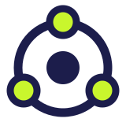
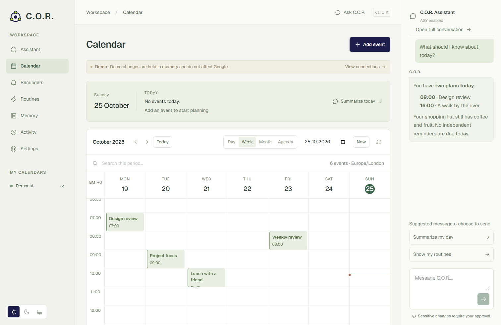
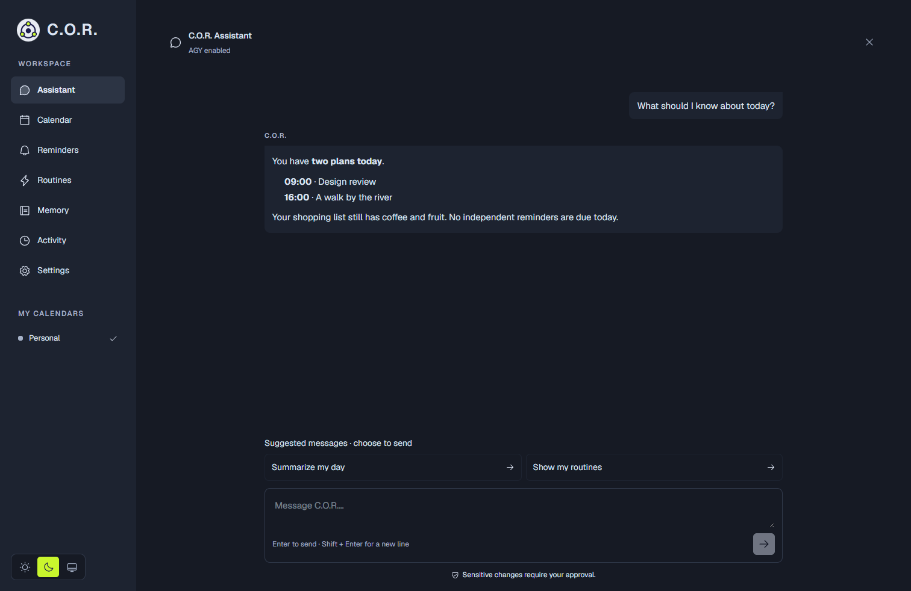

<p align="center"></p>
<h1 align="center">C.O.R.</h1>
<p align="center"><strong>Your plans, reminders and memory. On your own server.</strong></p>
<p align="center">Central Operations & Routine · Cognitive Orchestration & Response</p>
<p align="center"><a href="LICENSE"></a> </p>

C.O.R. is a **self-hosted personal planning assistant** that connects Google Calendar, independent reminders, scheduled briefings and durable personal memory. Use the web workspace or your own Telegram bot. Fixed reminders run without an LLM; AI is reserved for interpretation, research and briefings.

This is a focused personal assistant, **not an unrestricted computer agent**. It cannot run arbitrary shell commands, install skills from chat or silently expand its permissions. Each installation belongs to one owner.



## Try it in a minute

**Installing with an AI assistant?** Give it [SETUP.md](SETUP.md). The guide includes a copyable prompt, safe demo/persistent routes, the owner-controlled Google steps, secret handling, verification and a final handover. No GitHub Actions or paid fallback is required.

With Docker Desktop or Docker Engine and Compose:

```sh
git clone https://github.com/aliumutidiz/cor-assistant.git
cd cor-assistant
docker compose -f compose.demo.yaml up --build -d
```

Open **http://localhost:5173**. The first build downloads dependencies and takes longer than subsequent starts. No account, API key or database is needed. The demo is local and disposable: changes disappear when the container restarts. Google, Telegram and AI are disconnected; it does not simulate successful AI actions.

Stop it with `docker compose -f compose.demo.yaml down`. Use [persistent installation](docs/INSTALLATION.md) before relying on stored records or notifications.

Prefer Node.js? Install **Node.js 24 LTS** (22+ supported), then:

```sh
npm ci
npm run setup -- --demo
npm run dev
```

The wizard never overwrites an existing `.env`. An existing configuration takes precedence; use a fresh folder for a separate demo.

## What it does

| Area              | Available today                                                                                                               |
| ----------------- | ----------------------------------------------------------------------------------------------------------------------------- |
| Calendar          | Day, week, month and agenda views; search, range export, cached navigation, timed and all-day events, recurrence and guests   |
| Calendar controls | Validated event/calendar/sharing operations, current versions, conflict detection and explicit approval for sensitive changes |
| Reminders         | One-off or event-relative reminders, rescheduling, cancellation and Telegram delivery without an LLM                          |
| Routines          | Time zones, cron previews, pause/resume, manual runs, durable history; deterministic checks or AI daily/next-week briefings   |
| Personal memory   | Ideas, purchases, facts, explicit tasks, owner profile, reusable weekly/monthly programs and shopping lists                   |
| Conversations     | Full workspace, new chats, context reset, per-exchange forgetting, searchable history, exports and draft recovery             |
| Telegram          | Owner allowlist, private/group destinations, text and voice commands, approval buttons and scheduled delivery                 |
| Research          | Optional SearXNG search and bounded page reads, with citations and explicit availability limits                               |
| Voice             | Optional offline transcription and opt-in Google speech generation with buffered playback and replay cache                    |
| Appearance        | Light, dark and device theme; responsive desktop and mobile layouts                                                           |



## A memory that survives the model

The database is the source of truth. Records and conversations belong to C.O.R., not a provider session. Changing the LLM adapter does not erase them.

- **Small owner profile:** name, reply language and style are learned through onboarding or explicit conversation. English is the interface default; English and Turkish are supported saved reply preferences.
- **Structured long-term records:** original content, source, timestamps, revisions and archive state remain available. Programs and shopping lists retain their typed data.
- **Retrieval instead of replay:** indexed search selects relevant records and older conversation matches. Bounded context prevents the entire archive from being resent on every request.
- **Deterministic scheduling:** reminders, program occurrence calculation and ordinary routines do not need the model to remember or wake up.
- **Controlled changes:** updates require current record versions. Completion and archiving preserve history; credentials are rejected from personal memory.

Profile/context separation is inspired by [OpenClaw's memory design](https://docs.openclaw.ai/concepts/memory). C.O.R. implements its own database-backed records and guarded operations. Retrieval is lexical, with multilingual normalization; semantic embeddings, automatic lifelong consolidation and a web skill editor are **not claimed** in this preview.

Read the [memory architecture](docs/BRAIN-AND-PERSONAL-RESOURCES.md) and [skill system](docs/SKILLS.md).

## Connect your own services

For persistent use, run `npm run setup` and choose **Persistent installation**. It generates independent encryption/session secrets and reads your downloaded Google OAuth client locally. Then start PostgreSQL, migrate and open the application:

```sh
docker compose up -d db
npm run migrate
npm run doctor
npm run dev
```

The wizard asks for your owner email and application origin. Register `<APP_ORIGIN>/api/oauth/callback` on your Google OAuth **Web application** client and enable Google Calendar API. The authorized owner signs in, connects Calendar and completes Profile & appearance and Connections in Settings. See the [step-by-step guide](docs/INSTALLATION.md).

Telegram bot tokens, owner/group IDs, research endpoints and voice preferences are configured in Settings. Tokens are stored encrypted and are never returned to the browser. Database credentials, owner-login client, HTTPS and isolation controls remain operator configuration, outside chat.

### About AI access

C.O.R. ships a provider interface and an isolated **AGY CLI adapter**. The adapter is optional, disabled by default and requires a separately installed CLI, an authenticated account, compatible model and verified Linux isolation. Consumer subscriptions do not imply a supported server API or permission for every integration. Review your provider's current terms and eligibility; this project does not promise free or unlimited model access.

There is **no automatic paid-model fallback**. The portable Docker preview intentionally has no AGY credentials or host terminal access. Ordinary calendar forms, records and deterministic schedules work independently of AI. See [AGY verification](docs/AGY-VERIFICATION.md).

## Deployment and recovery

The portable application/database stack uses a private Compose network. Published ports bind to loopback. A production installation additionally requires HTTPS, owner authentication, PostgreSQL and independently generated secrets; invalid configurations fail closed.

For a home Linux server, reviewed systemd examples provide restarts, a persistent scheduler, encrypted pre-deploy backups, health checks and rollback to the previous app release. The update controller is installed separately and is never self-replaced from repository content. Public source does not grant contributors access to a running installation.

- [Installation and optional modules](docs/INSTALLATION.md)
- [Production deployment and restoration](docs/DEPLOYMENT.md)
- [Continuous deployment](deploy/continuous-deployment.md)
- [Security model](docs/SECURITY.md) · [Report a vulnerability](SECURITY.md)

**Keep the encryption and backup keys separately from database backups.** Restoring an app release is not a database rollback. Test restoration in a separate database.

## Privacy and trust boundaries

Your database stays on your infrastructure. Selected messages and relevant context are sent to the configured model to answer a request; this is **not an offline-only product**. Google receives Calendar operations, Telegram receives messages and optional speech generation sends the spoken text to Google. Research queries reach the configured search service and its engines.

External event descriptions, websites and memory content are treated as data, not authority. Models receive validated tool contracts, not OAuth tokens or application credentials. Writes use idempotency keys, version checks and recorded outcomes. Sensitive sharing, series and bulk changes require content-bound approval. Unknown results remain unknown rather than being reported as success.

See [data flow and limits](docs/SECURITY.md). Avoid shared Telegram groups containing people who should not see your assistant's replies: the owner allowlist protects commands, not other members reading group messages.

## Development

```sh
npm ci
npm run check
npm test
npm run build
npx playwright install chromium
npm run test:e2e
```

Browser tests start isolated demo services and do not need personal credentials. The optional live PostgreSQL suite requires a disposable `TEST_DATABASE_URL`; it must never point at production. Native AGY and speech integrations need their own Linux verification.

| Directory             | Responsibility                                                |
| --------------------- | ------------------------------------------------------------- |
| `src/`                | React workspace and accessible controls                       |
| `shared/`             | Validated contracts, schedules and domain types               |
| `server/`             | Authentication, operations, storage, integrations and workers |
| `skills/`             | English bootstrap, policy and on-demand skill packages        |
| `deploy/`, `scripts/` | Optional infrastructure, setup, diagnostics and backups       |
| `tests/`, `e2e/`      | Security, domain, persistence and browser verification        |

Read [CONTRIBUTING.md](CONTRIBUTING.md), [architecture](docs/ARCHITECTURE.md), [API contracts](docs/API.md), [conversation controls](docs/CONVERSATIONS.md) and [assistant languages](docs/LANGUAGES.md). The [execution review](docs/AGENT-REVIEW-2026-10-25.md) records the latest logic fixes and verification boundaries.

## Status and limits

**Early preview · v0.2.0.** This release is intended for a single technical owner running their own installation. It is not a hosted multi-user service, a native Android app, an email client or an arbitrary automation engine.

The web app and standard container setup are portable; isolated AGY deployment is Linux-specific. Verification runs locally and on the owner-managed Linux server; GitHub Actions is disabled and no hosted runners are required. Windows and Linux have been exercised; macOS verification remains pending. Google permissions and provider availability remain external dependencies.

Complex “this and following” recurrence edits are deliberately restricted; unsupported series should be edited in Google Calendar. Notifications require the server to be running and Telegram to be configured. Native mobile push, Gmail integration and UI-managed custom skills are future work. Scheduled AI briefings use a limited snapshot and disclose incomplete data.

## License and attribution

Licensed under **PolyForm Noncommercial 1.0.0**. Noncommercial use, modification and redistribution are permitted under its terms; commercial use is not granted. This is source-available software, not OSI-approved open source. See [LICENSE](LICENSE), [NOTICE](NOTICE) and the [licensing guide](docs/LICENSING.md). Earlier releases, including v0.1.0, retain their original AGPL-3.0-only license. The orbit identity is part of this project. C.O.R. is independent of Google, Telegram and OpenClaw; third-party names and marks belong to their owners. See [THIRD_PARTY_NOTICES.md](THIRD_PARTY_NOTICES.md).
